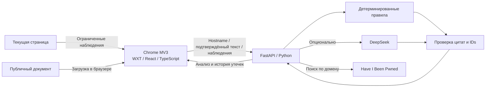

# AmIFooled

**Что сайт обещает. Что видно на странице.**

AmIFooled — расширение для Chrome, которое помогает разобраться в условиях сайта:
сопоставляет текст политики конфиденциальности с ограниченными наблюдениями страницы
и показывает известные утечки домена из Have I Been Pwned.

Результат содержит замечания, цитаты, доступные наблюдения и ограничения проверки.
Это основание внимательнее изучить условия, а не заключение о безопасности сайта
или доказательство нарушения.

Проект команды **KrapivaTeam**, созданный на VibeHack в ФКН НИУ ВШЭ.

[Быстрый запуск](#быстрый-запуск) · [Как пользоваться](#как-пользоваться) ·
[Данные и приватность](#данные-и-приватность) · [Разработка](#разработка) ·
[Документация](#документация)

## Возможности

| Возможность | Что делает расширение |
| --- | --- |
| Наблюдения страницы | Показывает число cookies, доступных JavaScript, и домены сторонних ресурсов из Resource Timing. |
| Поиск соглашения | Ищет ссылки на политику, соглашение и cookies на русском и английском. Можно указать свою ссылку. |
| Анализ документа | Сопоставляет выбранный текст с наблюдениями по правилам; при настроенном серверном ключе добавляет анализ DeepSeek. |
| Проверяемые ссылки в выводах | Сверяет цитаты с исходным текстом и идентификаторы наблюдений с переданными фактами. |
| История утечек | Запрашивает публичный каталог HIBP по домену сайта, показывает источник и даты инцидентов. |
| Добровольный бейдж | Для отдельно разрешённых сайтов проверяет известные утечки при открытии страницы. |
| Независимые результаты | Ошибка HIBP не скрывает анализ документа, а недоступность модели оставляет проверку по правилам. |

Без ключа модели работает режим **rules**. Для поиска известных утечек через HIBP
нужен интернет, но ключ HIBP в текущей реализации не используется.
Архив версий политик и сравнение изменений пока не реализованы.

## Быстрый запуск

Самый короткий путь — запустить backend через Docker и собрать расширение отдельной
командой. Нужны Git, Chrome/Chromium, Docker с Compose v2 и BuildKit.
Первая сборка скачивает образы и зависимости.

### 1. Получить исходники и запустить API

```sh
git clone https://github.com/Vroote/AmIFooled.git
cd AmIFooled
docker compose up --build -d --wait
```

Для клонирования нужен доступ к репозиторию. Если исходники уже скачаны,
выполните только последнюю команду из их корня.

Проверка готовности:

```sh
curl http://127.0.0.1:8000/health
# {"status":"ok"}
```

[Swagger UI](http://127.0.0.1:8000/docs) доступен после запуска.
Без `.env` и платного ключа API проверяет текст по детерминированным правилам.

### 2. Собрать расширение

Из корня репозитория:

```sh
docker build --file apps/extension/Dockerfile --target export --output type=local,dest=./dist .
```

Сборка создаст:

- `dist/chrome-mv3/` — папку для установки в Chrome;
- `dist/amifooled-chrome.zip` — архив для передачи и ручной установки.

### 3. Установить в Chrome

1. Откройте `chrome://extensions`.
2. Включите **Режим разработчика / Developer mode**.
3. Нажмите **Загрузить распакованное расширение / Load unpacked**.
4. Выберите `dist/chrome-mv3` и закрепите AmIFooled на панели браузера.

ZIP нужно сначала распаковать: Chrome ожидает папку с `manifest.json`.
После обновления сборки нажмите Reload на карточке расширения.

Остановить backend:

```sh
docker compose down
```

В контейнере API слушает порт 8000, а на компьютере доступен только через
`127.0.0.1`. База данных и постоянные тома для запуска не нужны.
Подробности, смена порта и готовые CI-артефакты — в [Docker-инструкции](docs/DOCKER.md).

## Как пользоваться

1. Откройте обычный HTTPS-сайт и нажмите значок AmIFooled.
   Расширение соберёт доступные наблюдения и автоматически запросит историю утечек
   по имени текущего сайта. Текст политики на этом этапе на анализ не отправляется.
2. Нажмите **«Найти соглашение»**. При необходимости используйте
   **«Вставить свою ссылку»** и укажите публичную HTML-страницу документа.
3. Проверьте источник и текст в разделе **«О документе и отправке»**.
   Для документа с другого origin Chrome может запросить отдельное разрешение.
4. Нажмите **«Проверить»**, чтобы отправить текст и наблюдения на backend.
   Если включён DeepSeek, текст также будет передан провайдеру модели.
5. Изучите краткую сводку и раскройте нужные замечания, цитаты, наблюдения
   и пояснения **«Как читать результат»**. Источники HIBP доступны в истории утечек.

Фоновая проверка при навигации включается отдельно в **«Настройках сайта»**.
Она отправляет только hostname разрешённого сайта, без текста политики.
Разрешение можно отозвать в расширении или в настройках Chrome.

### Как читать результат

- **`rules` / `llm`** — способ анализа: заданные правила или правила с дополнением модели.
- **Недостаточно данных** — полноценное сопоставление не удалось. Замечания только
  о документе всё ещё возможны, если модель выделила условия для проверки.
- **Ноль инцидентов HIBP** — в каталоге не найдено совпадений, а не «утечек никогда не было».
- **`?` на бейдже / число неизвестно** — источник недоступен или проверка не завершена.
- **`fixture`** — явно помеченные синтетические данные для разработки, не сведения о сайте.

## Данные и приватность

| Действие | Что передаётся |
| --- | --- |
| Открытие popup | Backend получает hostname для проверки известных утечек. |
| Поиск и загрузка политики | Браузер обращается к публичному документу без cookies, credentials и referrer. Сам поиск не запускает анализ. |
| Нажатие «Проверить» | Backend получает hostname, подтверждённый текст и ограниченные наблюдения: домены ресурсов и число видимых cookies. |
| Анализ с DeepSeek | Провайдер получает текст и наблюдения из запроса анализа. API-ключ хранится только на сервере. |
| Разрешённая фоновая проверка | Backend получает hostname, HIBP — домен для поиска в каталоге. |

Расширение не отправляет имена и значения cookies, значения полей форм,
историю посещений, полный DOM или полные URL посещаемых страниц и ресурсов.
Публичный текст документа перед отправкой очищается от email, частей URL и управляющих
символов. Такая очистка не заменяет проверку содержимого пользователем.

Backend не сохраняет тексты политик и не логирует тела запросов. Кэш HIBP ограничен
и хранится в памяти процесса; настройки добровольной проверки — в `chrome.storage.local`.
Постоянной базы данных нет.

Разрешения расширения: `activeTab`, `scripting`, `storage` и доступ к заданному backend.
Optional host permissions запрашиваются для конкретных сайтов по действию пользователя.
Объявление `*://*/*` в optional permissions само по себе не выдаёт доступ ко всем сайтам.

### Ограничения проверки

- Resource Timing отражает только доступную часть загрузок главного frame.
  Это не полный аудит сетевого трафика, трекеров или разрешений сайта.
- Счётчик `document.cookie` не видит HttpOnly cookies. Сторонний ресурс может быть
  CDN или шрифтом и сам по себе не доказывает передачу персональных данных.
- Поиск документа эвристический. Проверяется выбранный документ, а не весь юридический
  пакет. PDF, авторизация, редиректы, антибот-защита и JS-only страницы могут мешать загрузке.
- Политика ограничена 20 000 символами, запрос — 100 наблюдениями. Обрезка текста
  отображается пользователю.
- Совпадение цитаты и ID проверяет ссылки в ответе модели, но не гарантирует правильность
  интерпретации. Замечания требуют самостоятельной оценки.
- На внутренних страницах Chrome, в Chrome Web Store и инкогнито сбор недоступен.
- Backend рассчитан на локальный MVP. Публичное размещение требует отдельной настройки
  аутентификации, квот, ограничения запросов и HTTPS.

## Настройка DeepSeek

Модель необязательна. Реальные вызовы оплачиваются через API-аккаунт провайдера.

Для Docker скопируйте корневой пример и заполните `LLM_API_KEY` локально в редакторе:

```sh
cp .env.example .env
docker compose up -d --wait
```

В PowerShell вместо `cp`: `Copy-Item .env.example .env`.

| Переменная | По умолчанию | Назначение |
| --- | --- | --- |
| `LLM_API_KEY` | пусто | Без ключа используется только `rules`. |
| `LLM_BASE_URL` | `https://api.deepseek.com` | Адрес API модели. |
| `LLM_MODEL` | `deepseek-flash` | Модель для анализа. |
| `LLM_TIMEOUT_SECONDS` | `12` | Время ожидания провайдера в рамках общего бюджета анализа. |
| `AMIFOOLED_BREACHES_MODE` | `hibp` | `hibp` — реальные данные, `fixture` — явный синтетический режим. |
| `AMIFOOLED_API_PORT` | `8000` | Порт публикации API в Docker Compose. |
| `WXT_API_BASE_URL` | `http://127.0.0.1:8000` | Публичный адрес backend, задаётся при сборке расширения. |

За один анализ выполняется не более одного вызова модели без автоматических повторов.
Общий бюджет анализа — 15 секунд. При ошибке ключа, баланса, таймауте или непроверяемом
ответе остаются правила с пояснением причины.

Не помещайте ключи в `WXT_*`: эти переменные входят в браузерную сборку.
Не коммитьте `.env` и не передавайте его вместе с расширением. При смене порта API
пересоберите расширение с соответствующим `WXT_API_BASE_URL`.

## Архитектура



HTTP к API выполняется в service worker расширения. Backend обращается к настроенному
провайдеру модели и фиксированному API HIBP, не загружает произвольные URL документов.
Навигация, смена вкладки и закрытие popup отменяют операции; поздний ответ не должен
попасть в результат другой страницы.

Контракт генерируется по цепочке:

```text
Pydantic + FastAPI → contracts/openapi.json → api.generated.ts
```

| Endpoint | Назначение |
| --- | --- |
| `GET /health` | Проверка готовности процесса API. |
| `POST /v1/analyze` | Анализ текста и наблюдений, режим, замечания и ограничения. |
| `GET /v1/breaches?hostname=…` | Известные инциденты домена, источник и время проверки. |

Интерактивные схемы — в `/docs`, примеры запросов и ответов — в
[`contracts/fixtures`](contracts/fixtures). Fixtures синтетические.

## Разработка

Нужны **Node.js 22+**, npm, **Python 3.12+** и Chrome/Chromium.
Команды ниже предназначены для macOS/Linux и выполняются из корня репозитория.
В Windows используйте `.venv\Scripts\python.exe` и `.venv\Scripts\uvicorn.exe`.

### Backend

```sh
python3.12 -m venv .venv
.venv/bin/python -m pip install -r apps/api/requirements-dev.lock
.venv/bin/python -m pip install --no-deps -e apps/api
.venv/bin/uvicorn app.main:app --reload --host 127.0.0.1 --port 8000 --no-access-log
```

Для локального запуска с моделью скопируйте `apps/api/.env.example` в `apps/api/.env`,
заполните ключ в редакторе и экспортируйте переменные **до запуска Uvicorn**:

```sh
set -a
. apps/api/.env
set +a
```

Сам Uvicorn в этой конфигурации `.env` не загружает.
Compose читает корневой `.env`, а не `apps/api/.env`.

### Расширение

Во втором терминале:

```sh
npm ci
npm run dev
```

Для production-сборки и ZIP:

```sh
npm run build
npm run zip --workspace @amifooled/extension
```

Ручная установка: `chrome://extensions` → Load unpacked →
`apps/extension/.output/chrome-mv3`.
При другом адресе backend задайте `WXT_API_BASE_URL` в окружении сборки
или `apps/extension/.env` и пересоберите расширение.

### Проверки

После установки зависимостей:

```sh
npm run lint
npm run typecheck
npm test
npm run test:popup
npm run build
.venv/bin/ruff check apps/api scripts
.venv/bin/ruff format --check apps/api scripts
.venv/bin/python -m pytest apps/api/tests -q
```

При изменении API обновите обе генерации и проверьте diff:

```sh
.venv/bin/python scripts/export-openapi.py
npm run contracts:types
git diff -- contracts/openapi.json apps/extension/lib/api.generated.ts
```

Docker smoke, без вызовов внешних API:

```sh
python3 scripts/smoke-docker.py
```

CI проверяет backend, расширение, актуальность контракта и контейнерный smoke;
собирает артефакты `chrome-mv3` и `docker-chrome-mv3`. Unit-тесты используют моки.
Ручная проверка настоящего расширения в Chrome дополняет автоматические тесты.

### Структура репозитория

```text
apps/api/             FastAPI, правила, LLM, HIBP и backend-тесты
apps/extension/       Popup, сборщик, поиск документов, service worker и тесты
contracts/            OpenAPI и синтетические примеры API
scripts/              Генерация контракта, Docker smoke и GitHub-процесс
docs/                 Технические инструкции и записи проверок
```

Правила работы с issues, ветками, контрактами и независимым review — в
[AGENTS.md](AGENTS.md). Генерируемые файлы не редактируются вручную.

## Если что-то не работает

| Проблема | Что проверить |
| --- | --- |
| API недоступен | Выполните `curl http://127.0.0.1:8000/health` и `docker compose ps`. Адрес API в сборке расширения должен совпадать с адресом запущенного backend. |
| Политика не найдена | Укажите конечную публичную HTTPS-ссылку на HTML-документ. PDF и страницы за авторизацией не поддерживаются. |
| Chrome не разрешил загрузку | Повторите действие и подтвердите доступ к конкретному origin. Само объявление optional permission доступа не даёт. |
| Вместо `llm` получен `rules` | Посмотрите ограничения в ответе: ключ не задан, отклонён, исчерпан баланс либо провайдер не ответил вовремя. |
| Утечки недоступны | Проверьте соединение с HIBP. Недоступность источника не означает ноль инцидентов. |
| После навигации сбросился результат | Откройте popup заново или обновите контекст проверки: старые ответы не переносятся на новую страницу. |
| Порт 8000 занят | Измените порт API и адрес сборки расширения по [Docker-инструкции](docs/DOCKER.md#если-порт-8000-занят). |

## Документация

- [Запуск через Docker и передача сборки](docs/DOCKER.md)
- [Интеграция, отмена запросов и выполненный Chrome smoke](docs/INTEGRATION.md)
- [Поиск и загрузка соглашения](docs/POLICY-DISCOVERY.md)
- [Сбор наблюдений страницы](docs/COLLECTOR.md)
- [Утечки домена и кэш HIBP](docs/BREACHES.md)
- [Добровольная проверка при навигации](docs/NAVIGATION.md)
- [Контракт API](docs/API.md)
- [Правила разработки и review](AGENTS.md)
- [Дизайн интерфейса](DESIGN.md)
- [Исходный план хакатона](docs/HACKATHON.md)

Отдельные технические документы содержат записи конкретных этапов разработки
и исторические номера задач. Актуальные команды основного запуска приведены выше,
формы API определяются кодом и сгенерированным OpenAPI.

## Лицензия

Файл `LICENSE` пока не добавлен. Условия использования и распространения исходного
кода должны быть определены владельцами проекта.
