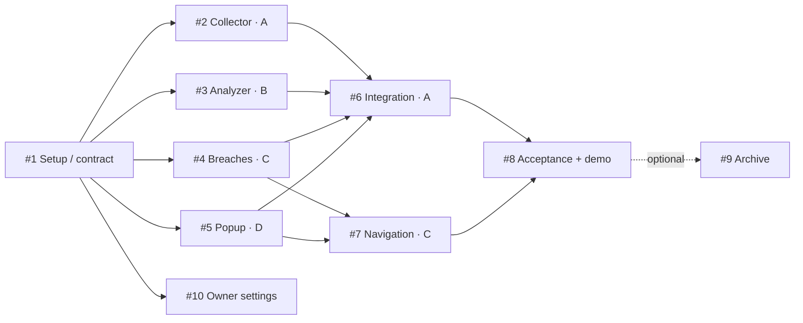

# AmIFooled: реалистичный план на 6 часов

Цель демо: посетитель разрешает проверку сайта → видит число **известных** утечек →
сопоставляет публичную политику с ограниченными наблюдениями страницы → получает
объяснимый сигнал с цитатой и источником, включая честное «данных недостаточно».

План рассчитан на **четыре параллельных исполнителя A/B/C/D и координатора** (координатор
может быть одним из команды), с разными GitHub identities для review. Время относительно
начала работы, не обещание конкретного дедлайна. Оценки — активная работа без ожидания
доступов; review и интеграция учтены отдельно. На двух исполнителях такой объём за шесть
часов ненадёжен: сократить до ручной проверки + HIBP, оставить автообход и LLM на потом.

## Бэклог и зависимости

| Issue | Поток | Мин | Зависимости | Итог |
|---|---|---:|---|---|
| [#1](https://github.com/Vroote/AmIFooled/issues/1) setup | Coordinator | 30 | — | Каркас, контракт, CI, правила |
| [#2](https://github.com/Vroote/AmIFooled/issues/2) collector | A | 75 | #1 | Ограниченные наблюдения + выбранная политика |
| [#3](https://github.com/Vroote/AmIFooled/issues/3) analyzer | B | 100 | #1 | Rules, цитаты, optional LLM/fallback |
| [#4](https://github.com/Vroote/AmIFooled/issues/4) breaches | C | 75 | #1 | HIBP + PSL + bounded cache |
| [#5](https://github.com/Vroote/AmIFooled/issues/5) popup | D | 90 | #1 | UI на фиксированных typed fixtures |
| [#6](https://github.com/Vroote/AmIFooled/issues/6) integration | A | 60 | #2, #3, #4, #5 | Полный ручной путь |
| [#7](https://github.com/Vroote/AmIFooled/issues/7) navigation | C | 60 | #4, #5 | Opt-in бейдж при заходе |
| [#8](https://github.com/Vroote/AmIFooled/issues/8) acceptance/demo | D + все | 60 | #6, #7 | Проверенная сборка и 3-минутное демо |
| [#9](https://github.com/Vroote/AmIFooled/issues/9) archive | B, stretch | 50 | #8 | Diff подготовленных версий, вне MVP |
| [#10](https://github.com/Vroote/AmIFooled/issues/10) protections | Vroote | 15 | #1 | Enforcement и Project automation |

Все issue содержат детальные AC, область файлов, tests и handoff. Созданы реальные
GitHub связи `blocked by`; они также записаны в поле Project `Depends on`. Зависимости
помогают координации, но сами по себе не запрещают преждевременный merge.

**Критический путь:** #1 → #3 → #6 → #8. Расчёт: 30 + 100 + 15 review + 60 +
15 review + 60 + 15 final review = **295 минут**, ещё **65 минут** на исправления,
перезапуски и репетицию. #5/#7 — близкий параллельный путь: задержка UI переносит и
интеграцию, и бейдж. Ожидание доступа/admin approval не включать молча в эти оценки.

## Расписание и handoff

| Время | A | B | C | D / координатор |
|---|---|---|---|---|
| 00:00–00:30 | Общий контракт, запуск | Общий контракт | Проверка HIBP | Setup merge, выбор reviewer |
| 00:30–01:45 | #2 collector | #3 analyzer до 02:10 | #4 breaches | #5 popup до 02:00 |
| 01:45–02:25 | Review #4, затем #5 | Закончить #3 | Review #2, подготовить #7 | Review #3, подготовить QA |
| 02:25–03:25 | #6 integration | Поддержка API / QA fixtures | #7 после merge #5 | Сценарии #8, UI fixes |
| 03:25–03:55 | Исправления интеграции | Review #6 | Исправления навигации | Review #7, smoke |
| 03:55–04:55 | Помощь QA | Помощь QA / review | Помощь QA | #8 acceptance + demo |
| 04:55–05:30 | Только критичные fixes | Только критичные fixes | Только критичные fixes | Повтор smoke, zip, скринкаст |
| 05:30–06:00 | Feature freeze | Никаких новых фич | Проверка fallback | Репетиция и резерв |

Archive #9 не помещается надёжно вместе с резервом: начинать только если core принят
раньше графика и остаётся минимум 45–50 минут. Базовая конфигурация не должна расходовать
весь хакатон на DevOps; #10 выполняется параллельно владельцем.

## Контрольные точки и сокращение объёма

- T+30: setup approved/merged, четыре потока запущены. Если approval задерживается,
  черновики можно начать от setup HEAD, но перед merge обязательны main и повторные checks.
- T+90: нет ключа LLM → rules mode остаётся основным, ключ не блокирует UI/API.
- T+145: API/collector/UI готовы к соединению. Если backend отстаёт, UI готовится на
  помеченных fixtures; такой mock не считать интеграцией или завершённым MVP.
- T+235: рабочий сквозной путь. Если отстаём — убрать архив и украшения; при необходимости
  координатор явно согласует перенос #7, сообщив, что демо пока работает по клику.
- T+295: приёмка core; дальше только дефекты и репетиция. Не добавлять новый provider/crawler.

## Что сознательно не входит

Регистрация, БД, публичный deploy, Web Store публикация, email/password breach search,
полный аудит сетевого трафика/permissions, автоматический сбор всего DOM, юридические
вердикты, live Wayback crawler, непрерывный глобальный мониторинг. Feature #7 ограничен
выбранными пользователем сайтами; это сохраняет реальность автоматической проверки без
скрытой отправки истории браузера.

## Координация файлов

A владеет collector и интеграционным controller, B — `analysis/`, C — `breaches/` и
`navigation/`, D — popup/components/styles. `background.ts`, `main.py`, `wxt.config.ts`
редактируются маленькими подключениями модулей после договорённости в issue.
Контракт меняет координатор/владелец API с уведомлением зависимых агентов.
Review budget 10–15 минут, без ожидания финала всей задачи: draft PR помогает заранее.

## Definition of Done

AC выполнены, relevant tests и `ci` зелёные, независимый approve для текущего HEAD,
comments разрешены, merge в main, issue закрыт, Project синхронизирован, следующий
владелец получил handoff. Скриншоты/сведения об ограничениях приложены. Название задачи
«готово» не заменяет реальный smoke test в Chrome.
